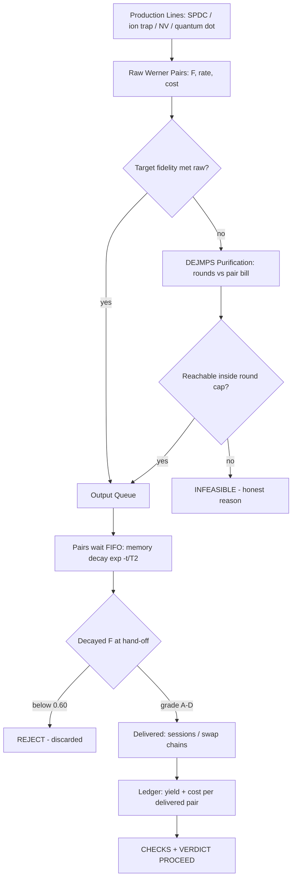
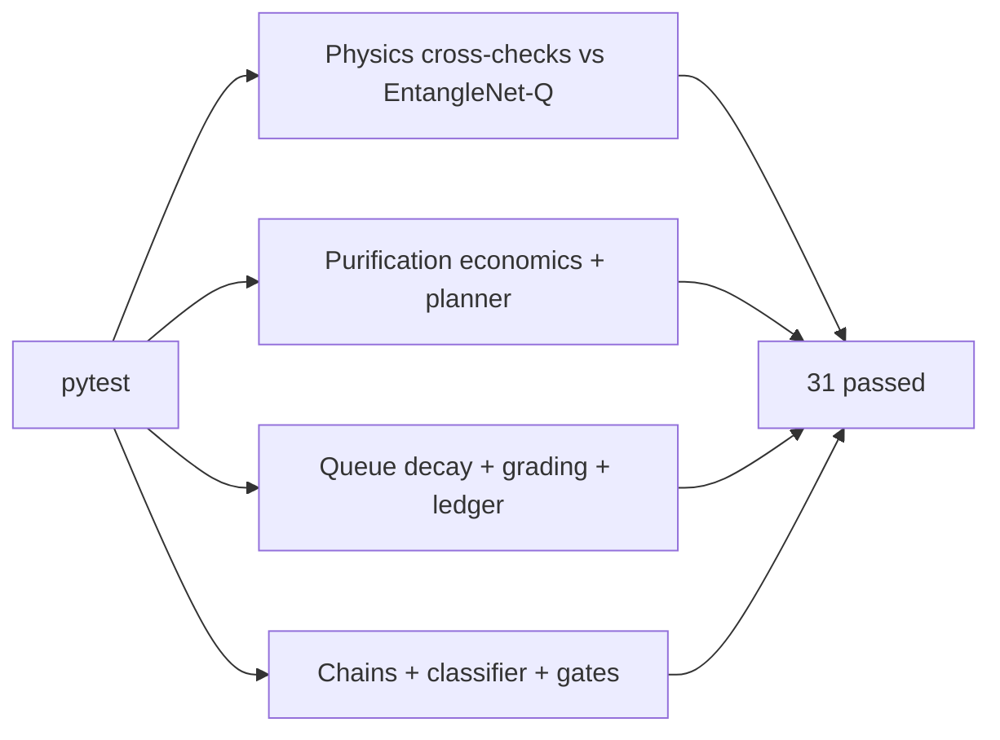
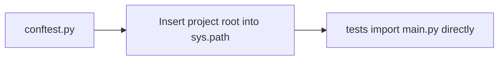
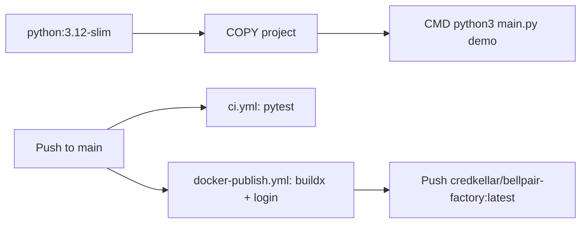

# BellPair-Factory 🏭⚛️

**Bell Pair / Entanglement Generation Factory Lab** — by Darion Kellar

BellPair-Factory is an **educational Bell pair factory lab** in ONE pure-Python file. It is the **supply layer** of Darion's quantum network stack — the floor underneath everything else:

- **TeleportX** = the teleportation **protocol** (one hop, one Bell pair). 🌀
- **EntangleNet-Q** = the **physics layer**: what a link, a swap, a purification round, and a memory wait can and cannot do. 🔗
- **TeleportNet-Router** = the **routing layer**: sessions, paths, deadlines, contention. 🛰️
- **BellPair-Factory** = the **factory layer**: where the raw pairs come from, at what fidelity, at what rate, at what cost — and what it takes to turn raw production into delivered pairs good enough to teleport with. 🏭

Four **production lines** (SPDC photon, trapped-ion, NV-center, quantum-dot — all labeled SIM parameters) each trade fidelity against rate against cost. On top of them the lab runs the factory's real arithmetic: **DEJMPS purification economics** (fidelity gain per round vs the raw pairs each round consumes), **entanglement swapping chains**, a **throughput planner** (raw pairs/sec and lines needed to sustain a teleportation session rate), **memory decoherence in the output queue** (a backlog is decaying inventory, not storage), **quality grading**, and **cost / yield accounting** per delivered pair. Every formula is the Werner-state model simulation-verified in EntangleNet-Q, and this lab cross-checks its headline numbers against EntangleNet-Q's published results: a raw pair at **F = 0.75 purifies to F = 0.9446 in 6 DEJMPS rounds**, and the classical teleport limit is **2/3 = 0.6667**. 🔬

Honest scope, stated up front: no production entanglement factory or supply service exists. This lab operates **no real hardware** — no source, detector, repeater, or network is controlled, ever — and its rates, fidelities, and costs are labeled simulation parameters, not promises. Every live / product claim sits behind a permanent HOLD gate (14 total). 🔒

[](https://github.com/kimanicollier44-cmyk/BellPair-Factory/actions/workflows/ci.yml)
[](https://github.com/kimanicollier44-cmyk/BellPair-Factory/actions/workflows/docker-publish.yml)

> ℹ️ These are the **live** workflow badges for this repo. They activate as soon as the `ci.yml` and `docker-publish.yml` files from the paste pack are pasted into `.github/workflows/` — until then they have nothing to report yet.

## 🧰 Tech Stack Badges & Full Architecture Tech Stack

### 💻 Core Programming Languages & Core Systems


- 🐍 Python 3.12, pure standard library (`math`, `hashlib`, `json`, `sys`) — zero dependencies, zero network, deterministic (double-run byte-identical)
- ⚛️ Quantum core: Werner pair model inherited from EntangleNet-Q — `F = (1 + 3w)/4`; DEJMPS purification map + success probability, swapping product rule, teleport output `(2F + 1)/3`, memory T2 decay — formulas sim-verified in EntangleNet-Q, cross-checked here against its published numbers
- 🏭 Factory engine: 4 labeled production lines, purification economics (`2 / P_success` pair bill per round), throughput planner, deterministic FIFO queue + decay simulation, quality grading, cost / yield ledger
- 🧠 TinyML kNN production-regime classifier (from scratch, stdlib): direct-use / purify-light / purify-heavy / infeasible
- 🪑 Council seats: Gemini Carbon 4 DECIDER (names-only, tighten-only) + Muse advisor (never overrides HOLD) + Google Flow plan-only (rendered = False, live = 0)

### ⛓️ Web3 & Infrastructure

- 🚫 **Not applicable — honestly.** No blockchain, no Web3, no tokens, and no live network of any kind: the "factory" in this lab is a labeled simulation inside one offline file. No fake badges here.

### ⚙️ Platform Support & Hardware Architecture


- 🖥️ Pure Python — runs anywhere Python 3.12+ runs (Linux, macOS, Windows), plus the `python:3.12-slim` Docker image
- 🔒 No hardware is controlled, ever: real quantum sources, detectors, repeaters, and satellite links are permanent HOLD gates (see the gate table below)

### ⚡ Low-Level Infrastructure & Performance

- 🚫 **No low-level code — honestly.** No C, no C++, no GPU, no compiled extensions: this is one interpreted Python file on purpose, so every number can be read, checked, and diffed. Performance here means honest arithmetic — an exact purification pair bill, a deterministic event-stepped queue simulation — all byte-identical between runs.

### 🛠️ DevOps & Build Tools


- 🐳 Docker (`python:3.12-slim`), GitHub Actions CI + Docker Publish (delivered in the paste pack)
- 🎯 Target image: `credkellar/bellpair-factory:latest`
- 🧪 Tests: `pytest` (31 tests) + the built-in CHECKS suite (53 checks) in `main.py`

### ☁️ Cloud Providers

- 🚫 **None — honestly.** No cloud provider is used or needed: the lab runs fully offline on your own machine or in a local Docker container. Docker Hub appears only as the registry the publish workflow pushes the image to.

## What this does?

1. 🏭 **Four production lines** — `spdc-line-a` (SPDC photon pairs: raw F = 0.75 — EntangleNet-Q's raw pair — at 1,200 pairs/s, 1.0 credit/pair), `ion-trap-line` (F = 0.95 at only 40 pairs/s, 25 credits/pair), `nv-center-line` (F = 0.85 at 300 pairs/s, 4 credits/pair), `quantum-dot-line` (F = 0.68 at 5,000 pairs/s, 0.2 credits/pair). No free corner of the fidelity / rate / cost triangle.
2. ✨ **Purification economics** — DEJMPS rounds priced honestly: each round multiplies the expected raw-pair bill by `2 / P_success(F)`. On the SPDC line: F 0.75 → 0.7885 → 0.8270 → 0.8635 → 0.8959 → 0.9231 → **0.9446** over 6 rounds, while the bill compounds 1 → 2.77 → 7.31 → 18.37 → 44.02 → 101.09 → **223.99 raw pairs per delivered pair**, and the line's delivered output falls from 1,200 to **5.36 pairs/s**. Fidelity is bought with pairs; the table shows the exchange rate.
3. 🔗 **Swapping chains** — Werner weights multiply, so a chain of 4 raw SPDC pairs ends at F = 0.3981, a teleport fidelity of **0.5988 — below the 0.6667 classical limit**. The same chain built from 6-round purified pairs ends at F = 0.8019 (teleport 0.8679). That gap is the whole reason the factory purifies *before* the chain, not after. Chain success probability (3 swaps at p = 0.90) is 0.729 — 1.37 expected attempts.
4. 📈 **Throughput planner** — "sustain 10 teleport sessions/s at F ≥ 0.90": SPDC needs 5 rounds and **1,010.93 raw pairs/s — one line at 84% load**; the ion trap needs 0 rounds but its whole line is 40 pairs/s; the NV line needs 2 rounds and delivers at **22.76 credits/pair — cheaper than the premium ion trap's 25.00**; the quantum-dot line is honestly **INFEASIBLE** at that target (best F ≈ 0.889 inside the 6-round cap, at any rate). Scale the demand and the planner answers in whole lines needed, not vibes.
5. ⏳ **Output queue + memory decay** — produced pairs wait FIFO for a session, and waiting decays them (`w · exp(−t / T2)`, T2 = 1.0 s). Balanced SPDC (1,200 in / 1,200 out, 0.25 s): 299 delivered, 0 discarded, avg F = 0.7500. Backlogged quantum-dot (5,000 in / 800 out, 0.5 s): 2,500 produced, only **196 delivered, 204 discarded** after decaying below the 0.60 grade floor, 2,100 still queued and expiring — the firehose floods its own warehouse.
6. 🏷️ **Quality grading** — every pair is graded at hand-off (A ≥ 0.95, B ≥ 0.85, C ≥ 0.75, D ≥ 0.60, REJECT below): a mixed batch of 9 grades out A×1, B×3, C×1, D×2, REJECT×2 — 7 usable. The fidelity on the production ticket is not the fidelity the session receives; grading happens where the pair changes hands.
7. 🧾 **Cost / yield ledger** — 10,000 raw SPDC pairs through 5 rounds: **98.9 delivered pairs** at F = 0.9231, yield 0.0099, total cost 10,000 credits, **101.09 credits per delivered pair**. The number a customer would actually pay, printed next to the raw-pair price that hides it.
8. 🧠 **Regime classifier + advisory seats** — a from-scratch kNN labels a proposed line + target `direct-use` / `purify-light` / `purify-heavy` / `infeasible`; Carbon 4 DECIDER with sha256 trace, Muse advisor, Google Flow plan-only, and a built-in CHECKS suite (53 checks).

## 🗺️ How it works — diagram per script

### `main.py` — the whole lab



### `tests/test_main.py` — verification



### `conftest.py` — test path setup



### `Dockerfile` + CI flow — container & publish



## Why is this cool?

1. 🏭 It completes the bottom of the quantum stack — TeleportX is the protocol, EntangleNet-Q is the physics, TeleportNet-Router is the control room, this is the **factory floor** that feeds all three.
2. ✨ Purification has an exchange rate, and this lab prints it: F 0.75 → 0.9446 costs **224 raw pairs per delivered pair** — the single most hidden number in entanglement demos.
3. 🔗 The raw-chain demo *fails on purpose*: 4 raw pairs swapped end-to-end teleport at 0.5988, **below the classical limit** — purification at the factory is not optional polish, it is the product.
4. 📈 The planner surprises: at F ≥ 0.90 the midrange NV line delivers **cheaper per pair (22.76) than the premium ion trap (25.00)**, and the fastest line (quantum dot, 5,000/s) cannot reach the target **at any rate**.
5. ⏳ The queue simulation kills the "stockpile pairs" intuition: overproduce into a backlog and your inventory decays below the grade floor — 204 of 2,500 firehose pairs discarded in half a second of simulated time.
6. 🏷️ Grading at hand-off, not at production: the lab grades the fidelity the session actually receives, after queue decay — the honest number.
7. 🧾 Yield is printed next to price: 10,000 raw pairs in, 98.9 delivered pairs out. Any factory quote that skips the yield is hiding 99% of the story.
8. 🚫 Infeasibility is a first-class answer: the planner says INFEASIBLE with the reason (target unreachable inside the round cap) instead of quietly rounding down the target.
9. 🧮 DEJMPS maps, product-rule chains, an event-stepped queue sim, and a kNN — all stdlib `math`. No numpy, no simulators, no network, anywhere.
10. 🎯 Deterministic end to end: run it twice, get byte-identical output — a factory you can diff.

## What problems this solves?

1. ❌ **Problem:** Entanglement demos assume perfect pairs appear for free. ✅ **Solution:** Pairs are produced by named lines with a fidelity, a rate, and a price — supply is modeled, not assumed.
2. ❌ **Problem:** Purification is quoted as a fidelity gain with no cost. ✅ **Solution:** Every round is priced in expected raw pairs (`2 / P_success`) and the delivered output rate is recomputed after the bill.
3. ❌ **Problem:** "Can this source feed my network?" gets answered by gut feel. ✅ **Solution:** The throughput planner converts a session rate + fidelity target into raw pairs/sec, whole lines needed, and line utilization.
4. ❌ **Problem:** Raw-pair chains get drawn on slides as if swapping were free. ✅ **Solution:** The product rule is applied in the open — a raw 4-pair chain lands below the classical teleport limit, and the purified chain shows the fix.
5. ❌ **Problem:** Produced pairs are treated as shelf-stable inventory. ✅ **Solution:** The FIFO queue simulation charges memory decay per pair while it waits, and discards what decays below the grade floor.
6. ❌ **Problem:** Faster production is assumed to mean more supply. ✅ **Solution:** The backlog scenario shows a 5,000/s line delivering *less* usable output than its rate promises, because its own queue becomes a decay chamber.
7. ❌ **Problem:** Pair quality is reported at production, sessions consume it later. ✅ **Solution:** Grading happens at hand-off, on the decayed fidelity — A / B / C / D / REJECT, with rejects counted, not shipped.
8. ❌ **Problem:** Cost per pair is quoted on raw pairs nobody can use. ✅ **Solution:** The ledger reports cost per *delivered* pair after purification yield — the only cost a session actually pays.
9. ❌ **Problem:** Line selection (which source for which job) has no first-pass tool. ✅ **Solution:** A kNN regime classifier labels line + target combos direct-use / purify-light / purify-heavy / infeasible before the exact planner runs.
10. ❌ **Problem:** Simulation tools quietly imply a supply service is next. ✅ **Solution:** 14 named HOLD gates return exit code 2 for every real-hardware, live-network, or production-factory claim, forever.

## How to install this?

1. 📋 Clone or download this project folder.
2. 🐍 Make sure Python 3.12+ is installed: `python3 --version`
3. ▶️ Run the full demo + checks (no arguments needed):

```bash
python3 main.py
```

4. 🧪 Run the test suite:

```bash
pip install pytest
python3 -m pytest -q
```

5. 🎛️ Try the other commands:

```bash
python3 main.py checks      # 53 built-in checks
python3 main.py sources     # the 4 production lines
python3 main.py purify      # SPDC purification economics table
python3 main.py plan        # all 4 lines priced at target F = 0.90
python3 main.py queue       # quantum-dot backlog: decay + discards
python3 main.py swap        # raw vs purified 4-pair chains
python3 main.py classify    # kNN production-regime report
python3 main.py brains      # Carbon 4 + Muse + Flow seats
python3 main.py holds       # list all 14 HOLD gates
python3 main.py hold-demo   # exits 2 - gated claims stay HOLD
```

6. 🐳 Or run it in Docker:

```bash
docker build -t credkellar/bellpair-factory:latest .
docker run --rm credkellar/bellpair-factory:latest
```

## Requirements

- 🐍 Python 3.12 or newer
- 📦 Dependencies: **none** (standard library only)
- 🌐 Network: **none** — fully offline
- 🧪 For tests only: `pytest`
- 🐳 Optional: Docker

## FULL project structure tree

```text
bellpair-factory/
├── main.py                  # the whole lab: physics layer, 4 production lines, purification economics, swap chains, throughput planner, queue + decay sim, grading, ledger, classifier, seats, HOLD gates
├── conftest.py              # puts the project root on sys.path for tests
├── tests/
│   └── test_main.py         # 31 pytest tests: cross-checks, economics, planner, queue, grading, gates, determinism
├── assets/
│   └── cover.png            # README cover image (2736 x 912)
├── Dockerfile               # python:3.12-slim, runs the demo
├── .gitignore               # __pycache__/, .pytest_cache/, *.pyc
└── README.md                # this file
```

> 📦 Delivered separately as paste packs (not in this tree): `.github/workflows/ci.yml` + `docker-publish.yml`, and the Docker Hub pack (100-char description, 350-char About, overview, categories).

## 🔒 HOLD gates — all 14, permanent

| # | Gate | What stays held |
|---|------|-----------------|
| 1 | `real_quantum_hardware` | No control of any real quantum hardware (sources, detectors, repeaters), ever |
| 2 | `live_network_control` | No control of any live quantum or classical network, ever |
| 3 | `claim_production_factory` | No production entanglement factory or supply service exists; this is a simulation lab |
| 4 | `guaranteed_fidelity_claim` | Fidelities here are model estimates under labeled assumptions, never guarantees |
| 5 | `guaranteed_rate_claim` | Production rates here are labeled simulation parameters, never promised output |
| 6 | `teleport_matter_claim` | No teleporting matter; only quantum states of simulated qubits are produced |
| 7 | `teleport_living_being_claim` | No teleporting living beings, ever |
| 8 | `claim_ftl_communication` | Entanglement never sends information faster than light; teleportation needs a classical channel |
| 9 | `live_qkd_key_use` | No generating or using real cryptographic keys for real traffic |
| 10 | `commercial_service_claim` | No commercial entanglement supply service is offered or implied |
| 11 | `bypass_no_cloning_claim` | The no-cloning theorem is not bypassed; purification consumes pairs, it never copies them |
| 12 | `live_satellite_link` | No commanding or tasking any real satellite link |
| 13 | `intercept_traffic_claim` | No intercepting, decrypting, or monitoring anyone's real traffic |
| 14 | `medical_data_transport_claim` | No claims about transporting real medical or personal data |

🧑‍⚖️ **Council seats:** Gemini Carbon 4 Extended Thinking — DECIDER (names-only, tighten-only, MAP → MODEL → STRESS → DECIDE, sha256 trace, `can_override_hold = False`) · Muse — advisor (`can_override_hold = False`) · Google Flow — plan-only (`rendered = False`, `live = 0`).

✅ **Verification:** pytest **31 passed** (project + clean copy) · built-in CHECKS **53/53** · double-run output **byte-identical** · `hold-demo` exits **2** · `main.py` **884 lines**, pure stdlib, zero network.

## Honest status

- 🧪 **Simulated, not real hardware.** Every source, rate, cost, and coherence time in this lab is a labeled simulation parameter chosen to teach the trade-offs. No real SPDC source, ion trap, NV center, or quantum dot was operated, measured, or controlled.
- 🔬 **Formulas are real; numbers are model outputs.** The Werner / DEJMPS / swapping / decay mathematics is the same model EntangleNet-Q verified against a from-scratch simulator, and the cross-checks (0.75 → 0.9446 in 6 rounds; classical limit 2/3) pass here — but a model output is an estimate under stated assumptions, never a guarantee about physical hardware.
- 🏭 **No factory exists.** There is no production entanglement supply service behind this lab, no live network consumes its pairs, and no session was ever actually fed. The planner plans a *simulated* supply chain.
- 🔒 **The HOLD gates are the product boundary.** Anything live — real hardware, real networks, real keys, real services — stays held, permanently, by design.

---

MIT © 2026 Darion Kellar · BellPair-Factory — educational simulation only 🏭
